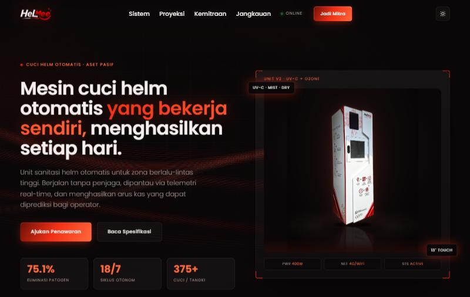

# HelMee website (showcase)

Marketing and partnership website (staging build) for an automatic helmet-sanitizing machine business in Indonesia, designed and built by me.

> **This is a showcase repository.** The source code is private. Request access via [LinkedIn](https://id.linkedin.com/in/ferdinand-klasse).

## What I built
- Single-page site covering the machine, how it works, location zones (campus, mall, gas station, station) and partnership paths for business owners and individual partners
- Light and dark theme
- WhatsApp quote and consultation links
- Legal pages: warranty, privacy policy, terms of service, shipping

## Tech
HTML, CSS, JavaScript.

## License
Copyright (c) 2026 Ferdinand Klasse. All rights reserved.

No permission is granted to copy, modify, distribute, or use this material or the related source code without written permission from the author.
